# RedNote Clone —— 仿小红书（RED / RedNote）全栈应用

[](https://github.com/Theater-ahyeon/rednote-clone/releases/latest)
[](LICENSE)
[](#0-环境要求)

> 基于对小红书 PC Web 端的逆向分析（构建产物静态分析 → 设计令牌 / 接口语义 / 数据模型），从零实现的一套**高保真仿小红书**应用。
> 一份 React 代码，同时跑在 **Web 浏览器、Android 客户端（Capacitor）、Windows 桌面客户端（Electron）** 三个端。

## 📦 直接下载安装包

**→ [Releases 页面](https://github.com/Theater-ahyeon/rednote-clone/releases/latest)**（当前 v1.0.0）

| 文件 | 平台 | 说明 |
|---|---|---|
| `rednote-clone-1.0.0-android.apk` | Android 7.0+ | 手机侧载或 `adb install` |
| `rednote-clone-1.0.0-setup.exe` | Windows 10/11 x64 | NSIS 安装程序（可选安装目录） |
| `rednote-clone-1.0.0-portable.exe` | Windows 10/11 x64 | 便携版，免安装双击即用 |

> 安装包未做代码签名，Windows SmartScreen 可能提示「未知发布者」——「更多信息 → 仍要运行」即可。
> 三个客户端都只负责界面，数据来自本机后端：`cd server && npm install && npm run seed && npm start`（默认 `http://localhost:3001`）；Android 端再执行 `adb reverse tcp:3001 tcp:3001`。

**体验账号：`demo` / `123456`**（内置 14 个用户、50 篇笔记、195 条评论，也可自行注册）

| 首页（双列瀑布流） | 笔记详情 | 搜索（热搜榜） | 个人主页 |
|:---:|:---:|:---:|:---:|
| 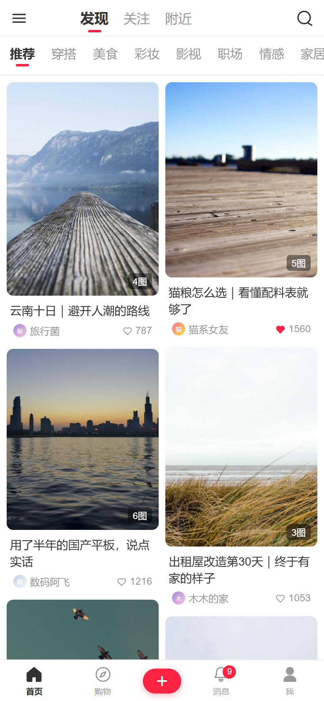 |  | 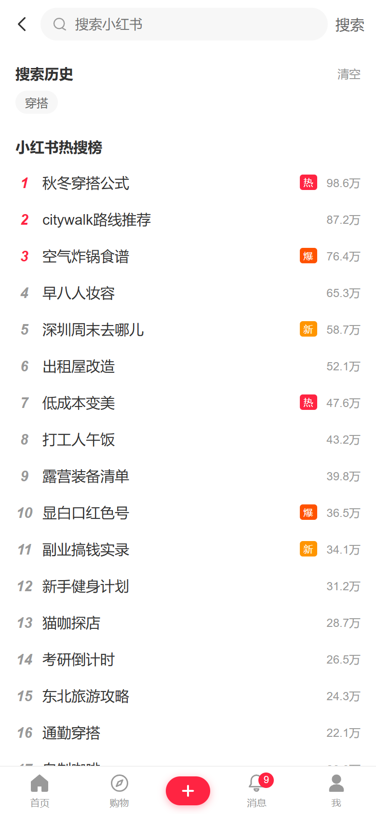 | 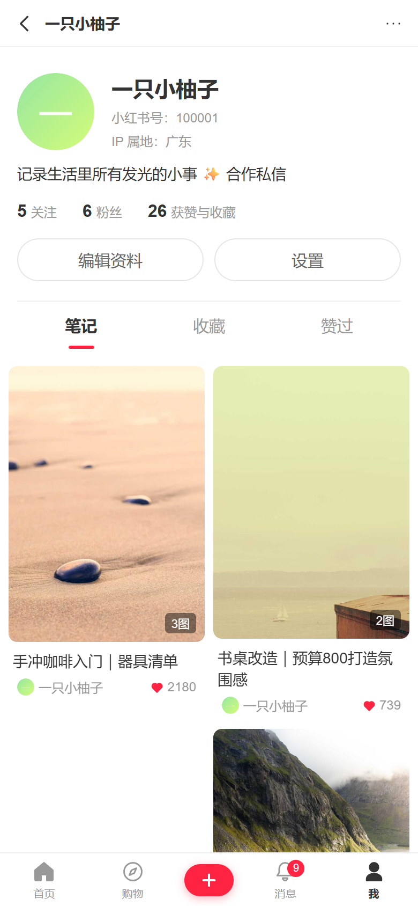 |

| 发布页 | 消息页 | 搜索结果 | 桌面端 / 移动端响应式 |
|:---:|:---:|:---:|:---:|
| 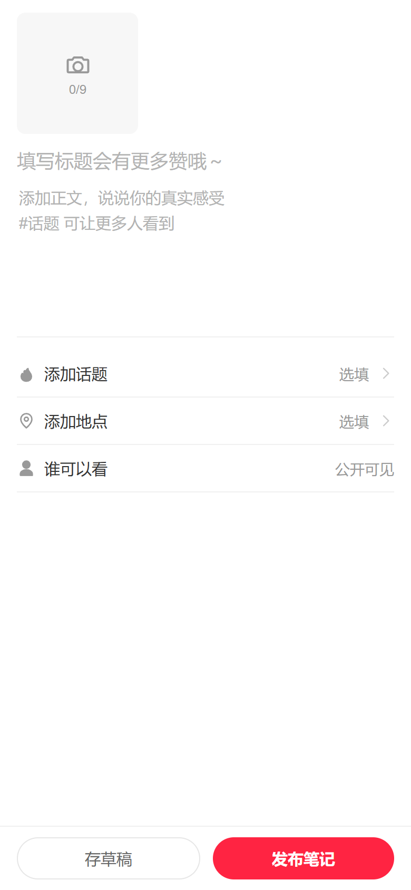 | 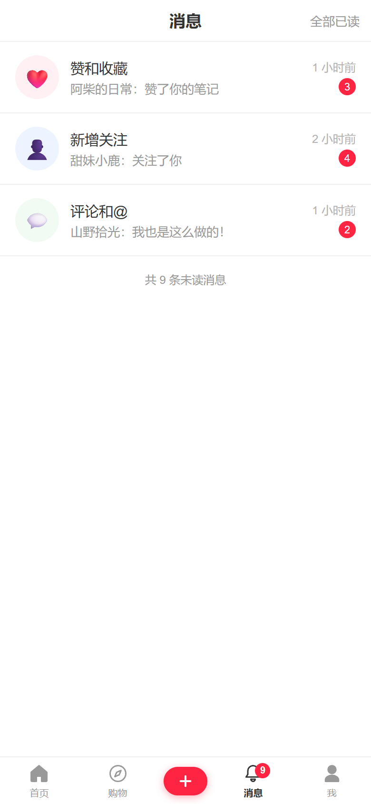 | 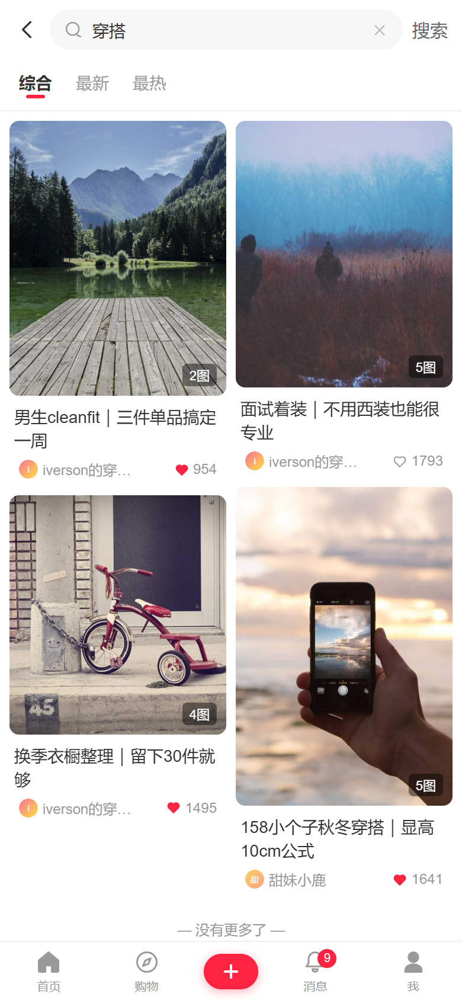 | 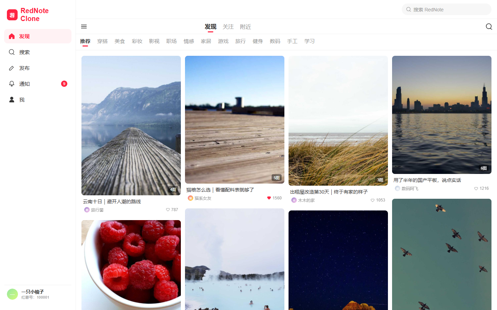 |

| 桌面端详情 | 桌面端搜索 | 桌面端消息 | 桌面端个人主页 |
|:---:|:---:|:---:|:---:|
| 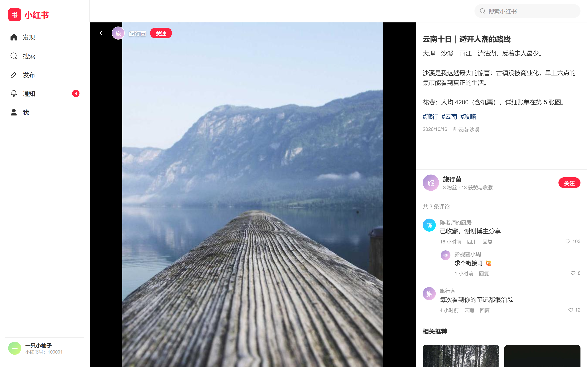 | 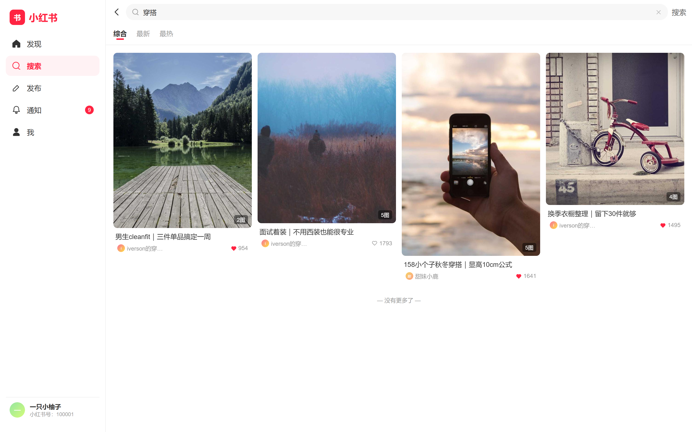 | 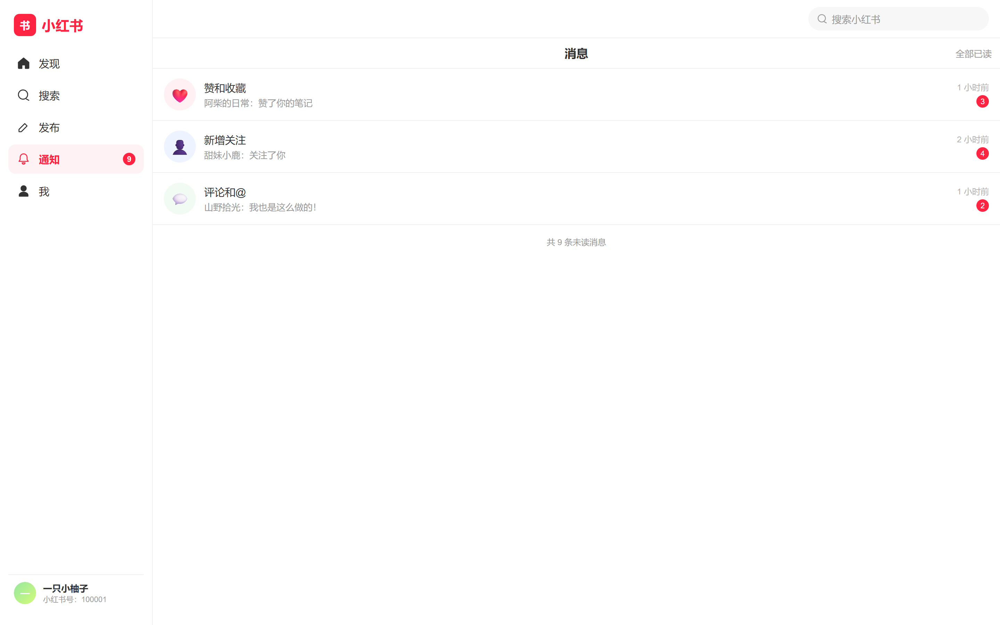 | 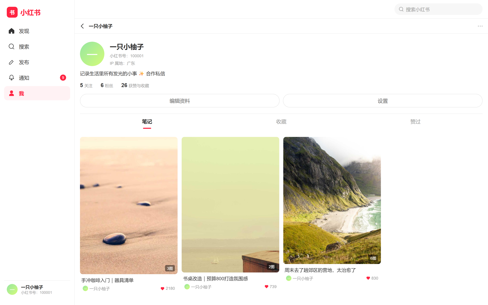 |

| Windows 客户端实拍（430×932 窗口） |
|:---:|
| 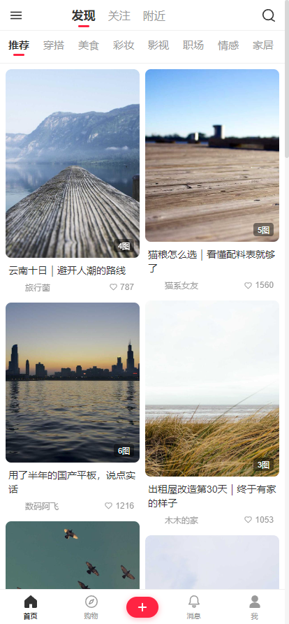 |

---

## ✨ 核心功能

- **首页信息流**：双列瀑布流（移动 2 列 → 桌面 5 列自适应）、「发现 / 关注 / 附近」频道、话题频道条、下拉刷新、无限滚动
- **笔记**：图文发布（最多 9 图，本地上传）、图片轮播详情、点赞 / 收藏 / 评论（二级评论）/ 分享数、相关推荐
- **搜索**：热搜榜（热/新/爆角标）、搜索历史、联想词、综合/最新/最热排序
- **社交**：注册登录（JWT）、关注 / 取关、粉丝与关注列表、个人主页（笔记 / 收藏 / 赞过 三个 Tab）、资料编辑
- **消息**：与官方一致的三个盒子（赞和收藏 / 新增关注 / 评论和@）、未读角标、全部已读

## 🧱 技术栈

| 层 | 技术 | 说明 |
|---|---|---|
| 后端 | Node.js 18+ / Express 4 / better-sqlite3 / JWT / Multer | 单文件 SQLite 落盘，零外部服务依赖，`npm run seed` 一键灌入演示数据 |
| 前端 | React 18 / Vite 5 / React Router 6 / Zustand | 单页应用，移动优先响应式（≥1024px 切换为 PC 左侧导航布局） |
| Android | Capacitor 7（WebView 容器） | 复用同一份 `web/dist` 构建产物，`gradlew assembleDebug` 直出 APK |
| Windows | Electron 33 | 无边框窗口 430×932（手机比例），electron-builder 打包 NSIS 安装包 / 便携版 |

> 为什么三端共用一份代码？小红书桌面版本身就是 WebView 架构（此前对同类产品的 asar 解包分析可证），因此 Web 端产物即天然是客户端 UI 内核；原生壳只负责窗口与容器，避免了三套 UI 的维护成本。

## 📁 项目结构

```
rednote-clone/
├─ server/                 # 后端 API
│  ├─ src/
│  │  ├─ index.js          # Express 入口（生产模式同时托管 web/dist）
│  │  ├─ db.js             # SQLite 建模（users/notes/likes/comments/follows/messages...）
│  │  ├─ seed.js           # 演示数据（14 用户 / 50 笔记 / 195 评论 / 热搜 / 消息）
│  │  ├─ middleware/auth.js    # JWT 解析 / 鉴权
│  │  ├─ routes/           # auth / notes / users / search / messages / upload / channels
│  │  └─ utils/            # JWT·bcrypt / 轻量图片尺寸解析 / 本地 SVG 占位图生成
│  └─ public/uploads/      # 上传与种子图片（seed 可重建）
├─ web/                    # 前端 SPA（三端共用）
│  ├─ src/
│  │  ├─ pages/            # Home / NoteDetail / Search / Publish / Messages / Profile / Login...
│  │  ├─ components/       # NoteCard(瀑布流) / SmartImage(断网兜底) / Layout / Toast / Icon
│  │  ├─ store/            # Zustand（token 持久化 + 未读角标）
│  │  ├─ api/              # fetch 封装（自动适配 代理/file:// 双模式）
│  │  └─ styles/global.css # 设计令牌（品牌红 #ff2442 等，全部来自逆向提取）
│  ├─ android/             # Capacitor 生成的 Android 原生工程（可直接 Android Studio 打开）
│  └─ capacitor.config.json
├─ desktop/                # Windows 桌面端（Electron）
│  ├─ src/main.js          # 主进程（430×932、后端探活引导页）
│  └─ resources/icon.png   # 应用图标（脚本生成的品牌红心形）
├─ scripts/                # dev.js 并行启动 / screenshot.js 截图 / android-icon.js 图标生成
├─ docs/
│  ├─ reverse-engineering.md   # 逆向分析报告（方法、设计令牌、接口对照、合规声明）
│  ├─ api.md               # 全量接口文档
│  └─ screenshots/         # README 截图（scripts/screenshot.js 自动生成）
└─ README.md
```

## 🚀 快速开始

### 0. 环境要求

- Node.js ≥ 18.18（推荐 20/22）
- Android 构建（可选）：JDK 21 + Android SDK（Capacitor 7 要求 Java 21，compileSdk 35）

> 本仓库开发验证环境：Windows 11 / Node 22.22 / JDK 21.0.12（Temurin）/ android-35 / Gradle 8.10.2

### 1. 启动后端（API :3001）

```bash
npm install          # 根目录一次装好 server + web 两个 workspace
npm run seed         # 灌入演示数据（14 用户 / 50 笔记），体验账号 demo / 123456
npm run start        # 启动 API → http://localhost:3001
```

### 2. 网页版（开发模式，热更新）

```bash
npm run dev          # 并行拉起 API(:3001) 与 Vite(:5173)
# 打开 http://localhost:5173
```

### 3. 网页版（生产模式，单端口部署）

```bash
npm run build        # 构建 web/dist
npm run start        # Express 同时托管 API 与静态页面 → http://localhost:3001
```

### 4. Android 客户端

```bash
npm run android:sync     # 构建（--base=./ --mode native）+ cap sync android
cd web/android
./gradlew assembleDebug  # 或用 Android Studio 打开 web/android 直接 Run
# 产物：web/android/app/build/outputs/apk/debug/app-debug.apk
```

**连接后端**（两种方式任选）：

```bash
# 方式 A：USB 调试端口反向代理（推荐，APK 内默认请求 http://localhost:3001）
adb reverse tcp:3001 tcp:3001

# 方式 B：局域网 IP
# 修改 web/.env.native → VITE_API_BASE=http://<电脑局域网IP>:3001 后重新 npm run android:sync
```

> 本机已验证可出包：`app-debug.apk`（约 4 MB）。换图标：`node scripts/android-icon.js` 后重新构建。

### 5. Windows 桌面客户端

```bash
cd desktop
npm install           # 安装 Electron（首次较慢）
npm start             # 加载 web/dist，连接 http://localhost:3001
                      # 后端未启动时会显示引导页而不是白屏

# 打包安装程序（NSIS + 便携版，输出 desktop/release/）
npm run dist          # 会自动先执行 npm run build:native（相对路径构建）
```

> 兼容性说明：桌面端默认开启 `in-process-gpu` / `disable-gpu-sandbox` / `no-sandbox`。
> 这是因为部分机器（虚拟显示适配器、远程桌面、无交互桌面会话）Chromium 独立 GPU 进程会崩溃、
> 渲染进程沙箱会挂起，导致白屏或秒退；本应用只加载本地 `file://` 资源与本机 API，可安全关闭。
> 需要恢复沙箱设 `REDNOTE_KEEP_SANDBOX=1`；需要完整 GPU 加速设 `REDNOTE_ENABLE_GPU=1`。
### 6. 重新生成 README 截图 / 应用图标（可选）

```bash
npm run docs:shot                 # 需先启动后端，用真实浏览器渲染各页面截图
node scripts/android-icon.js      # 重新生成安卓启动图标
```

## 🔌 接口说明

完整 REST 接口见 **[docs/api.md](docs/api.md)**，与小红书真实接口的字段对照（`noteId` / `cover` / `interactInfo` / `xsecToken` …）见 **[docs/reverse-engineering.md](docs/reverse-engineering.md)**。

```bash
curl http://localhost:3001/api/health
curl "http://localhost:3001/api/notes/feed?tab=recommend&limit=20"
curl -X POST http://localhost:3001/api/auth/login -H "Content-Type: application/json" \
     -d '{"username":"demo","password":"123456"}'
```

## 🎨 与官方的视觉对照

所有设计令牌均从小红书 PC Web 构建产物中逆向提取（详见逆向报告）：

| 令牌 | 官方值 | 本项目 |
|---|---|---|
| 品牌红 | `#ff2442` | 一致 |
| 字体 | PingFang SC / 14px 基准 | 一致 |
| 卡片圆角 | 8px | 一致 |
| 瀑布流实现 | `.note-item` 绝对定位 + JS 计算 | JS「最短列优先」分列（同视觉效果） |
| 消息页三盒子 | 赞和收藏 / 新增关注 / 评论和@ | 一比一还原 |
| 发布页标题占位 | 「填写标题会有更多赞哦～」 | 一致 |

## ⚠️ 合规声明

本项目为**前端逆向学习 + 全栈练手**用途：

- 未破解、未绕过小红书任何签名（`x-s` / `x-s-common`）或风控；未调用任何小红书真实接口
- 所有数据存于本地 SQLite，图片来自 picsum.photos 免费图库（断网自动回退本地 SVG）
- 与小红书（行吟信息科技有限公司）无任何关联，请勿用于商业用途

## License

MIT
